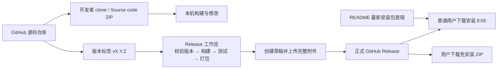
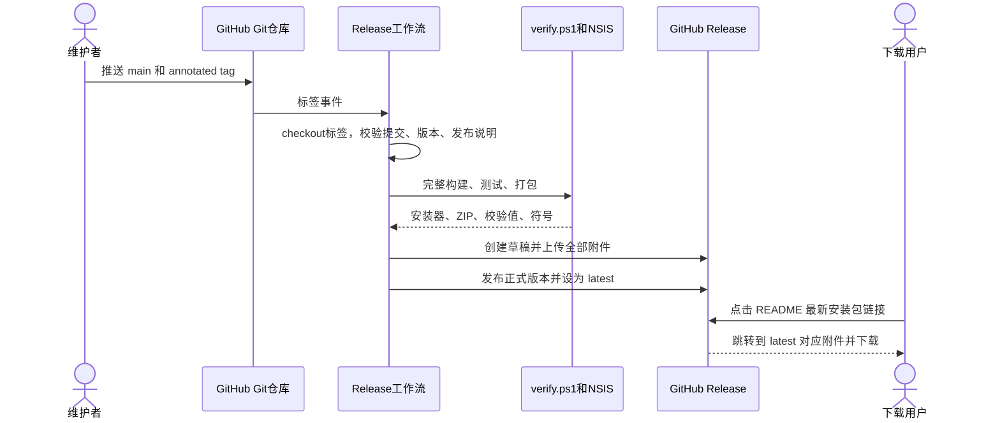

# 构建、打包与 GitHub Release

## 1. 两条交付路径



Git 中保存可维护的源码、测试、脚本和文档；构建目录由 `.gitignore` 排除。安装包和免安装包作为 Release 附件，避免每次 clone 都下载历史二进制。

## 2. 开发与构建环境

| 项目 | 要求 |
|---|---|
| 系统 | Windows 10/11 x64；测试使用 Windows API |
| SDK | `global.json` 中的 .NET SDK 10.0.401，允许同一功能带后续补丁 |
| Shell | PowerShell 7，命令为 `pwsh` |
| 安装器编译器 | NSIS 3.x，当前发布工作流使用 3.11 |
| Git | 获取源码、提交、版本标签 |
| GitHub CLI | 手动发布和查看工作流；CI runner 已提供 |
| J-Link 软件 | 仅连接真实探针时需要；编译、单元测试、Demo 不需要 |

Python 脚本是可选辅助工具：`extract_symbols.py` 使用 pyelftools，`make_icon.py` 使用 Pillow；常规构建不执行它们，也不重新生成已确认的图标/UI 资源。

## 3. 构建和测试

在仓库根目录运行：

```powershell
dotnet restore NewScope.slnx
dotnet build NewScope.slnx -c Release --no-restore
dotnet test tests/NewScope.Tests/NewScope.Tests.csproj -c Release --no-restore
```

运行 Demo：

```powershell
dotnet run --project src/NewScope/NewScope.csproj -c Release -- --demo
```

解决方案包含桌面项目、回归测试和压力工具。压力测试不会在日常 CI 中自动打开窗口运行；日常 CI 会编译压力工具，以检查接口兼容性。

## 4. 一键发布和打包

```powershell
pwsh -File tools/verify.ps1
```

执行顺序：

1. 从主项目读取 `Version`、`FileVersion`，核对 manifest 版本。
2. 还原解决方案依赖。
3. Release 构建桌面程序和压力工具。
4. 运行回归测试。
5. 发布 `win-x64` 自包含单文件程序，原生库采用自解压方式。
6. 归档本次 PDB，再从运行目录移除 PDB。
7. 复制用户说明和第三方声明，生成免安装 ZIP。
8. 使用 NSIS 生成安装器。
9. 为本次安装包、免安装 ZIP、PDB 归档写入 SHA256。

### 参数

```powershell
# 无 NSIS 时，仍构建、测试和生成免安装版
pwsh -File tools/verify.ps1 -SkipPackage

# 已另行验证测试时可跳过
pwsh -File tools/verify.ps1 -SkipTests

# 指定 NSIS 编译器
pwsh -File tools/verify.ps1 -NsisCompiler "C:\Program Files (x86)\NSIS\makensis.exe"
```

NSIS 会优先从 PATH 和常见安装目录查找。编译安装器不等于执行安装；脚本不会自动安装或启动产品。

### 产物

| 路径 | 用途 |
|---|---|
| `dist/publish/NewScope.exe` | 可直接运行的自包含桌面程序 |
| `dist/publish/symbols/stepperctrl.json` | 随附 Demo 符号；运行版需保留 |
| `dist/NewScope-Portable-win-x64.zip` | 完整运行目录的免安装包 |
| `dist/NewScope-Setup-win-x64.exe` | 推荐给普通用户的安装包 |
| `dist/SHA256SUMS.txt` | 本次附件的 SHA256 校验值 |
| `dist/symbols/NewScope-<version>-win-x64-<timestamp>-symbols.zip` | 对应程序的 PDB；用于 dump 分析 |

单文件指程序主可执行文件，自包含指附带 .NET 运行时。随附示例目录仍作为外部数据文件存在，所以免安装版应完整解压，安装器会自动放置全部运行文件。不要单独搬走 exe 后再期待示例目录仍可用。

安装位置默认 `%LOCALAPPDATA%\Programs\NewScope`，按当前用户安装，无需管理员提升；创建开始菜单入口，可选桌面快捷方式。设置、日志和诊断保存在 `%LOCALAPPDATA%\NewScope`，不会因替换程序目录自动迁移为其他位置。

### 校验下载

```powershell
Get-FileHash .\NewScope-Setup-win-x64.exe -Algorithm SHA256
```

将结果与同一 Release 的 `SHA256SUMS.txt` 比较。在类 Unix 环境，把附件放在同一目录后可以运行 `sha256sum -c SHA256SUMS.txt`；只下载部分附件时只检查对应行。

## 5. 清理与保留策略

```powershell
pwsh -File tools/clean.ps1
```

该脚本只删除项目已知的 `bin/obj/TestResults/.vs` 等生成目录，保留源码、文档、随附符号和 `dist/` 最终程序。不要删除用户的 `%LOCALAPPDATA%\NewScope` 来“清理构建”。

本次整理已删除旧安装器、构建目录和迭代压测结果，最终压测记录移至 `docs/testing/2026-10-26/`。以后构建可重新生成所有中间目录，构建结束后可以再次执行清理。

PDB 要与实际构建对应。保存新的符号归档后再清理旧归档，分析旧版本问题时保留对应 Release 的符号附件。

## 6. 版本标签与 GitHub Release

### 为什么需要标签

- Git 标签记录一次发布所对应的源码提交。
- Release 以该标签组织版本说明和安装附件。
- 下载者能找到程序的准确源码；维护者可回到对应提交分析问题。
- GitHub 自动为标签提供 Source code ZIP / tar.gz。

采用稳定版本标签 `vX.Y.Z`，例如 `v1.0.4`。`X` 用于不兼容变更，`Y` 用于功能版本，`Z` 用于兼容修复。使用带说明的 annotated tag。

### 发布前修改

1. 更新 `src/NewScope/NewScope.csproj` 的 `Version`；AssemblyVersion/FileVersion 随之派生。
2. 将 `src/NewScope/app.manifest` 的四段版本同步到 FileVersion。
3. 更新 README、CHANGELOG，新增 `docs/releases/vX.Y.Z.md`。
4. 完成本地验证，检查 Git diff，提交全部版本变更。
5. 确保没有凭据、用户配置、日志、dump、`bin/obj` 或 `dist` 进入提交。

示例：

```powershell
git push origin main
git tag -a v1.0.4 -m "NewScope 1.0.4"
git push origin v1.0.4
```

版本标签用于发布；仓库 Topics 是另一类“标签”，仅用于按 `j-link`、`oscilloscope`、`avalonia`、`embedded` 等主题检索，不参与版本构建。

### 自动发布流程

`.github/workflows/release.yml` 在推送 `v*.*.*` 标签时运行，也支持维护者手动选择已有标签：



CI 使用仓库提供的 `GITHUB_TOKEN`，只在 Release 工作流授予 `contents: write`。不需要在源码或脚本中填写个人 Token。日常 Verify 工作流保持只读权限。

若工作流失败，先查看失败日志；正式版本只在所有附件上传成功后发布。已发布的版本不覆盖源码、不移动旧标签，修正后使用新的修订版本。GitHub 可能对 Release 启用不可变发布，尤其不应依赖覆盖附件来修改已发布版本。

### 手动发布备用命令

在 `gh auth login` 已完成、标签已推送且本机构建与标签对应的前提下：

```powershell
gh release create v1.0.4 `
  dist/NewScope-Setup-win-x64.exe `
  dist/NewScope-Portable-win-x64.zip `
  dist/SHA256SUMS.txt `
  --repo jtrzhangjie/NewScope --verify-tag --draft `
  --title "NewScope v1.0.4" --notes-file docs/releases/v1.0.4.md

# 另行上传本次匹配的 PDB 归档；将占位路径换成实际文件名
gh release upload v1.0.4 "dist/symbols/<本次符号归档>.zip" --repo jtrzhangjie/NewScope
gh release edit v1.0.4 --repo jtrzhangjie/NewScope --draft=false --latest
```

自动工作流已经完成发布时，不再重复执行备用命令创建同名 Release。

### 稳定下载入口

```text
最新版本页面：
https://github.com/jtrzhangjie/NewScope/releases/latest

最新版安装包直接下载：
https://github.com/jtrzhangjie/NewScope/releases/latest/download/NewScope-Setup-win-x64.exe

最新版免安装包直接下载：
https://github.com/jtrzhangjie/NewScope/releases/latest/download/NewScope-Portable-win-x64.zip

固定 v1.0.4 安装包：
https://github.com/jtrzhangjie/NewScope/releases/download/v1.0.4/NewScope-Setup-win-x64.exe
```

附件名称跨版本保持稳定，内部产品版本和所属标签明确区分版本。`latest/download` 会由 GitHub 重定向到最新正式 Release 的对应附件。

## 7. 压力测试与发布判断

```powershell
pwsh -File tools/stress.ps1 -DurationSeconds 300 -Frames 120
```

压力测试需要交互式 Windows 桌面，与常规单元测试分开。可增加 `-DurationSeconds 3600` 检查更长时间运行。记录实际硬件、数据规模、UI 延迟、读间隙和进程内存，不能只报告平均采样率。

本次已验证情况见 [压力报告](STRESS_TEST_2026-10-26.md)。真实 J-Link、不同板卡、低内存和多显示器应按部署场景继续验证。
