# NewScope 软件技术文档

> 对应版本：1.0.4。图采用 Mermaid，GitHub 可直接渲染。图中只列核心成员，省略 MVVM 自动生成的属性、命令和部分辅助类。

## 1. 目标与业务边界

NewScope 将嵌入式固件的“变量名称和类型”关联到“运行时地址”，再通过 J-Link 读取数值，以波形和统计方式帮助观察算法行为。

主要业务包括：导入符号、选择变量和窗格、连接目标、连续采样、暂停/恢复、缩放与平移、导出 CSV、恢复工作区和收集诊断数据。

当前为 Windows x64 桌面程序，重点覆盖 32 位小端 Cortex-M 的常见 RAM 标量变量。它不承担固件编译、下载烧录或完整调试器功能。连接会请求目标继续运行，暂停采样不会暂停目标 MCU。

## 2. 总体架构与进程边界

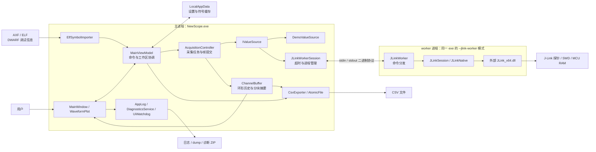

### 2.1 分层职责

| 层 | 主要对象 | 职责 |
|---|---|---|
| 视图 | `MainWindow`、`WaveformPlot` | 文件选择、窗口事件、输入交互、绘图、UI 定时刷新 |
| 协调 | `MainViewModel`、`ChannelViewModel`、`VariableNode` | 命令、状态、通道选择、窗格管理、绑定属性 |
| 数据与采集 | `SampleChannel`、`ChannelBuffer`、`AcquisitionController` | 帧写入、缓存、时间基准、生命周期、快照 |
| 设备 | `IValueSource`、`JLinkValueSource`、`IJLinkSession` | 数值来源、读块规划、协议客户端、原生访问 |
| 支撑 | `ElfSymbolImporter`、`CsvExporter`、`AppSettingsStore` 等 | 导入、导出、持久化、日志与诊断 |

采集和 CSV 服务依赖 `ISampleChannel`，不依赖具体的 UI ViewModel。`ChannelViewModel` 通过内部 `SampleChannel` 暴露同一份符号和缓存。

## 3. UML 类图

### 3.1 符号、通道和缓存

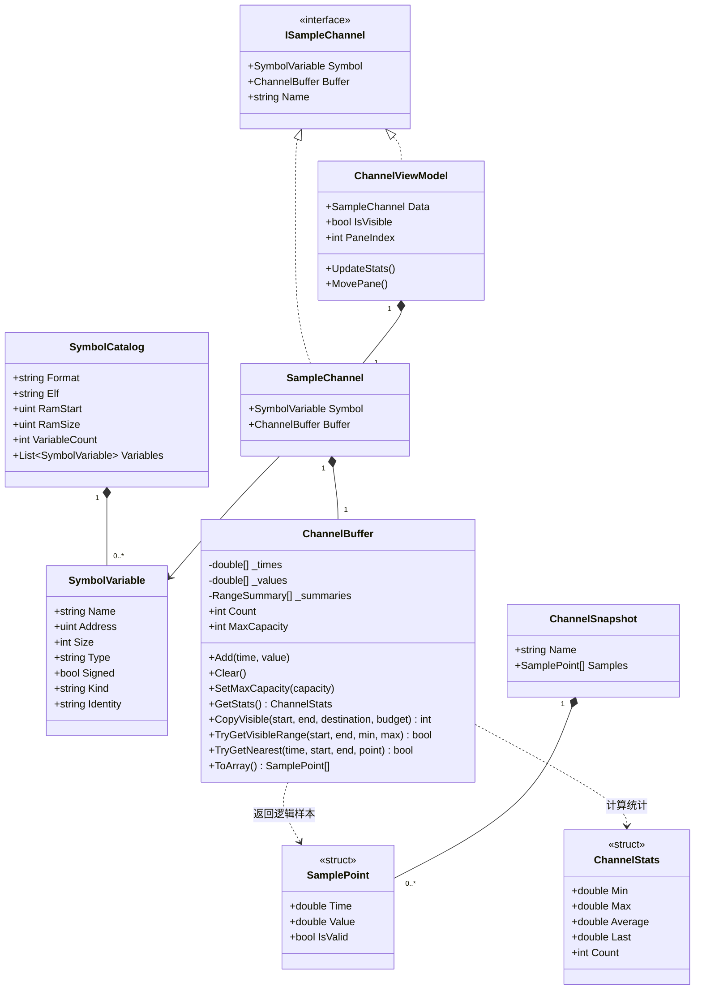

关键约定：

- `Identity = Name + "@" + Address`，同名不同地址的变量独立存在。
- `ChannelBuffer` 的时间有序，查找使用二分；底层为并行 `double[]`，不为每个采样分配对象。
- 无效数值可存在于历史中，但不参与有限值的范围/平均计算。统计 `Count` 是保留的样本数。
- 快照使用独立数组，后续采集覆盖环形缓存不会改变导出数据。

### 3.2 采集与 J-Link 访问

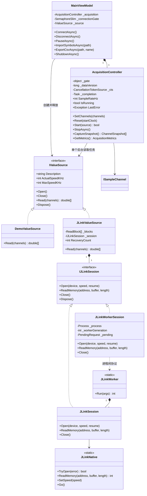

`JLinkWorkerSession` 在主进程实现 `IJLinkSession`；worker 内的 `JLinkSession` 直接访问 DLL。接口相同，运行位置不同。

## 4. 启动与工作区恢复

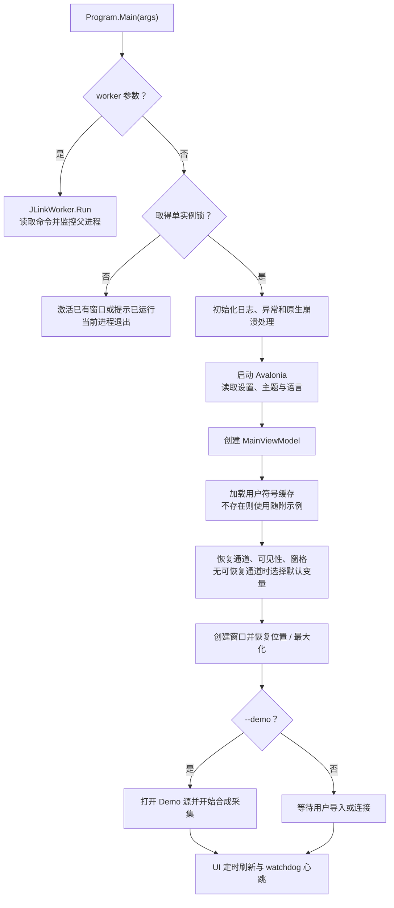

`AppSettingsStore` 对加载值进行规范化。工作区保存通道名称和可空地址；旧配置没有地址时按名称恢复，新配置优先按名称+地址恢复。固件重编译导致地址变化时，仅在名称唯一的情况下回退匹配，避免混淆多个同名静态变量。

## 5. 符号导入业务

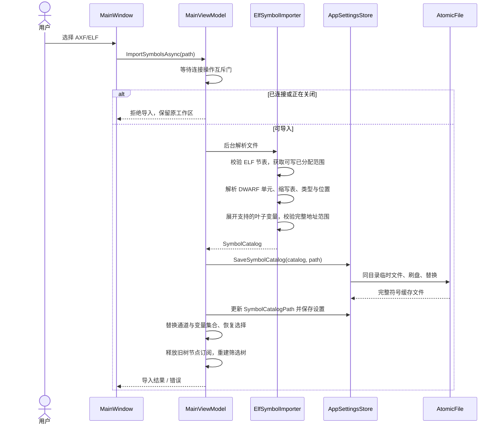

解析约束：

- 保留常见整数、浮点、布尔和枚举叶子，大小为 1/2/4/8 字节。
- 跳过无法求得绝对地址的位置、指针、位域和不支持的复杂类型。
- 小型标量数组最多展开 16 个元素；字符/字节字符串数组等按当前实现过滤。
- 按 `(Name, Address)` 去重，相同名称但不同地址不会静默丢弃。
- 变量的整个值必须落入某个可写分配范围；不是仅检查起始地址。
- 导入是解析，不会烧录固件；工具链优化可能使变量无可采集位置。

源码入口：`Services/ElfSymbolImporter.cs`，内部包含 ELF 读取、DWARF 读取和符号收集器。

## 6. 连接、读块规划与异常恢复

### 6.1 连接时序

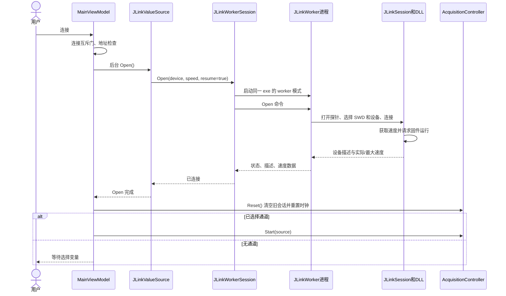

连接入口允许一次额外重试，间隔 500 ms。连接、断开、导入共享协调门，防止 F5 与连接按钮同时创建两个源。关闭过程中完成的打开操作会释放源，不再启动采集。

### 6.2 内存读块

`JLinkValueSource` 在通道数组引用或数量变化时重建计划：

1. 按目标地址排序。
2. 将相邻变量合并到读块，块长最多 512 字节，允许最多 64 字节间隙。
3. 每个块一次读取，随后按偏移解码各变量。
4. 解码使用小端规则，并转换为 `double`；8 字节整数超过 `double` 精确整数范围时会有精度限制。

读取失败时，源关闭会话并尝试重新打开，默认最多 2 次恢复尝试；恢复成功后重建读计划并再次读取。最终失败则交给采集控制器停止任务并保存错误。

### 6.3 worker 协议和超时

| 命令 | 编号 | 请求字段 | 正常响应载荷 |
|---|---:|---|---|
| Open | 1 | 设备字符串、速度 Int32、恢复运行 Boolean | 实际速度和最大速度两个 Int32 |
| Read | 2 | 地址 UInt32、长度 Int32 | 指定长度的内存字节 |
| Close | 3 | 无 | 空 |
| Ping | 4 | 无 | 空 |

响应统一为：`状态 Int32 + 消息字符串 + 载荷长度 Int32 + 载荷字节`，由 .NET `BinaryReader/BinaryWriter` 编解码；载荷上限 4 MiB。

- Open：20 秒；Read：4 秒；Close：2 秒。
- 同一会话串行发送请求，后台响应线程完成对应的 `TaskCompletionSource`。
- worker generation 防止已淘汰进程的响应完成新请求。
- 超时/通信异常停止 worker，必要时终止进程树；后续恢复创建新进程。
- worker 每秒检查父进程，父进程退出后 worker 自行退出。

4 秒是单次 Read 响应超时，不是包含恢复打开和进程清理在内的整个操作上限。

## 7. 采样帧、清空与状态生命周期

### 7.1 采样流程与同步点

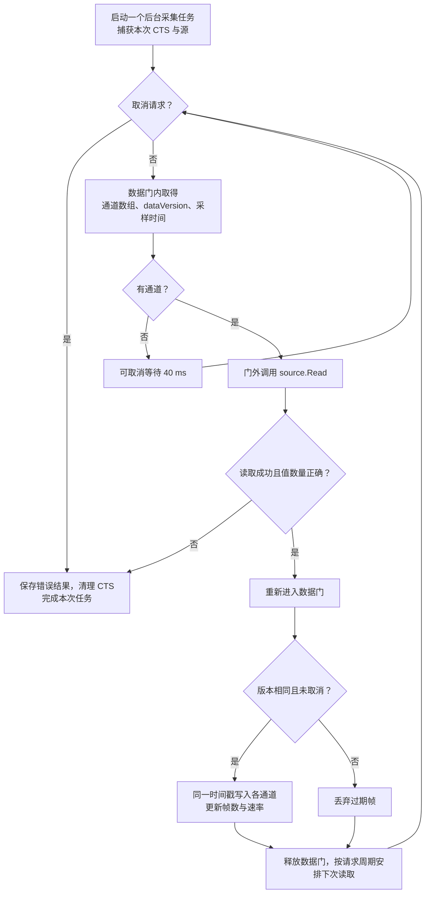

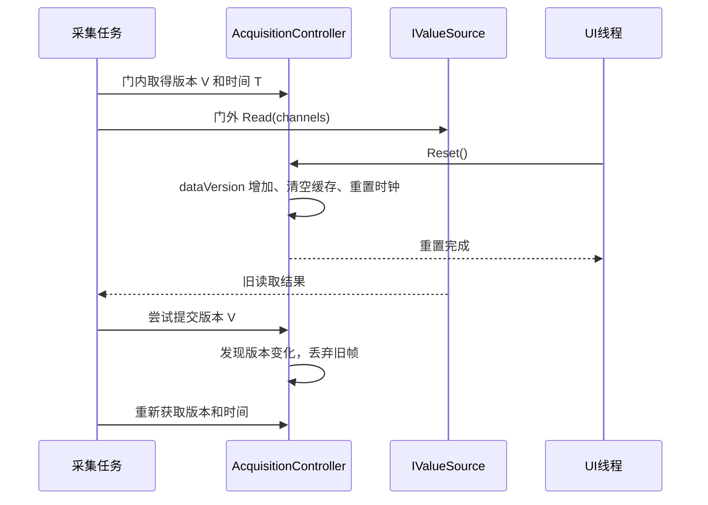

核心不变量：

- 读探针不持有数据门，因此原生读取等待不会阻止清空或获取已完成帧的快照。
- 同一帧的所有通道写入、重置、快照在同一数据门下互斥。
- 重连同时重置缓存和时钟；清空和通道变更增加版本号，阻止过期读取写入新状态。
- `StopAsync` 取消并等待任务，不提前释放还在使用的 CTS 或源。
- 任务结束清理状态后可以重新 `Start`；UI 只处理当前 runId 的完成通知。
- `GetMetrics` 是非阻塞的显示用遥测，避免 UI 等待大快照，不替代帧快照的一致性保障。

### 7.2 业务状态

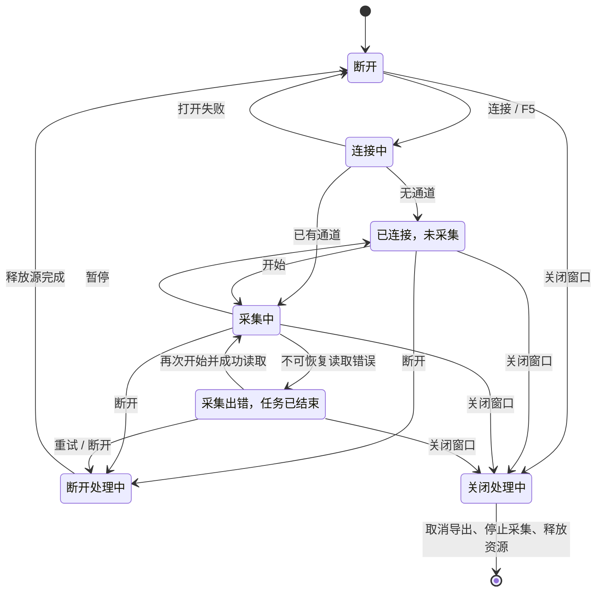

“采集错误”状态仍可能保留连接对象，不能仅用 `IsConnected` 判断采集任务是否存在。

## 8. 缓存与波形业务

### 8.1 数据结构与预算

- 环形数组按需增长，最大容量由采样率、60 秒目标历史及通道数计算；单通道默认容量上限 200,000 点。
- 样本预算 512 MiB，估算中包含每点两个 `double` 及分块摘要摊销；这是缓存预算，不包含整个 UI、运行时、原生绘图和导出副本。
- 每 64 个物理槽维护有限值数量、和、最小/最大值及其索引、最后有限值。更新仅重算相应小块，范围查询组合整块和边缘数据。
- `ToArray` 复制环形缓冲的两个连续物理区段，保持逻辑时间顺序，避免逐点取模。
- 可见区间用二分定位边界；最近点直接查找原始采样，不使用已降采样的近似点。

### 8.2 绘图流程

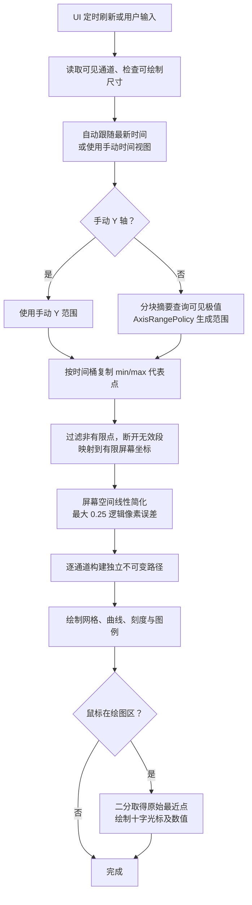

`CopyVisible` 在点数预算足够时保留端点及各时间桶最小/最大值，避免固定步长漏掉尖峰。屏幕简化只影响提交给绘图后端的几何，不修改原始缓存、统计、CSV 或光标读数。

`AxisRangePolicy` 对新极值立即扩展，持续较窄的范围达到约 2 秒后再收缩，减小自动 Y 轴抖动。极端有限数值使用有限端点和归一化坐标计算，避免溢出为原生绘图中的非有限坐标。

资源与交互约束：

- 单窗格点预算基于宽度和 64,000 点帧预算计算；高通道下减少每通道点数。
- 常规 UI 定时器 16 ms；通道数大于 32 时图表刷新间隔至少 66 ms，大于 128 时至少 200 ms。实际帧耗时仍受数据、窗口尺寸和机器影响。
- 可见通道统计每 250/500 ms 更新；隐藏通道统计每 2 秒更新，隐藏不停止采样。
- 时间滚轮视图范围 0.01–3600 秒；零垂直增量不缩放；丢失鼠标捕获时退出拖拽。
- 文字测量缓存有固定容量，暂存数组复用；图表离开视觉树时解除语言和集合订阅。
- **路径发布给渲染线程后不得重新打开或修改。** 采用每帧新建的不可变路径，避免 UI 线程与原生渲染线程同时访问可变对象。

## 9. CSV 导出与文件一致性

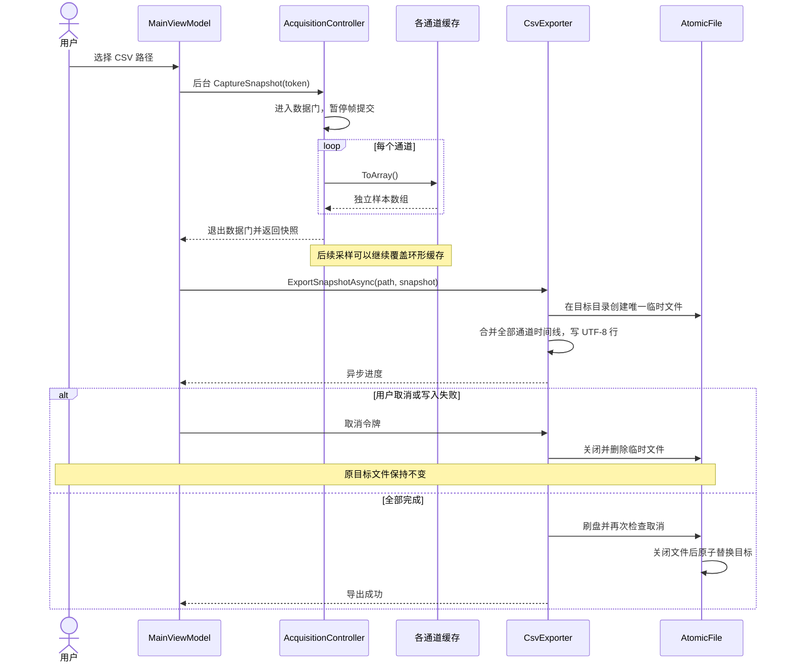

CSV 采用时间线并集，避免只选最长通道而漏掉其他通道的有效行。数值用区域无关 `G17`，时间用 6 位小数；缺值、NaN 和 Infinity 输出空单元格。重复通道名称用地址补充列名。进度和取消按批次检查，快照会临时增加接近一份历史数据的内存。

`AtomicFile` 也用于设置和导入符号缓存：同目录唯一临时文件、完整序列化/写入、刷盘、关闭后替换；失败清理临时文件。设置保存失败返回 `false` 并记录日志。

## 10. 诊断、退出与配置

| 组件 | 机制 |
|---|---|
| `AppLog` | 带时间、线程、进程和 session；5 MB 轮转；保留历史 |
| `DiagnosticsService` | 托管/原生异常摘要、Windows minidump、诊断 ZIP |
| `UiWatchdog` | 独立线程检查 UI 心跳，10 秒静默触发 hang 现场，恢复后重新允许报告 |
| `WindowPlacementPolicy` | 按屏幕工作区夹取已保存窗口位置 |
| `AppSettingsStore` | LocalAppData 设置、符号缓存与原子保存 |

关闭顺序：标记关闭 → 取消并等待导出 → 保存工作区 → 等待正在进行的连接/断开操作 → 停止采集 → 释放源和 worker → 解除订阅 → 允许窗口关闭。正常结束写入 clean-exit 标记。

诊断 ZIP 收集当前/历史日志、配置、系统与窗口信息、dump 目录最近文件。日志和 dump 可能含用户路径、符号和内存片段，问题反馈应由提供者确认可共享内容。

## 11. 验证和交付

- 回归测试：`tests/NewScope.Tests`，ELF 样本由测试代码生成，无本机固件路径依赖。
- 压力工具：`tools/NewScope.Stress`，独立执行满缓存绘图和真实窗口采集；反射调整测试时钟仅用于预填充场景，不是生产接口。
- 最终压测：[报告](STRESS_TEST_2026-10-26.md) 与 [原始数据](testing/2026-10-26)。
- 构建/安装/标签发布：[构建与发布](BUILD_AND_RELEASE.md)。
- 源码在 Git，安装包与免安装版在 GitHub Release；标签指向对应提交，SHA256 用于核对下载产物。

已验证负载不代表硬实时保证或所有硬件组合。J-Link 真实吞吐、掉电/拔线、多显示器、低内存及更长时间运行仍需按实际部署环境验证。
